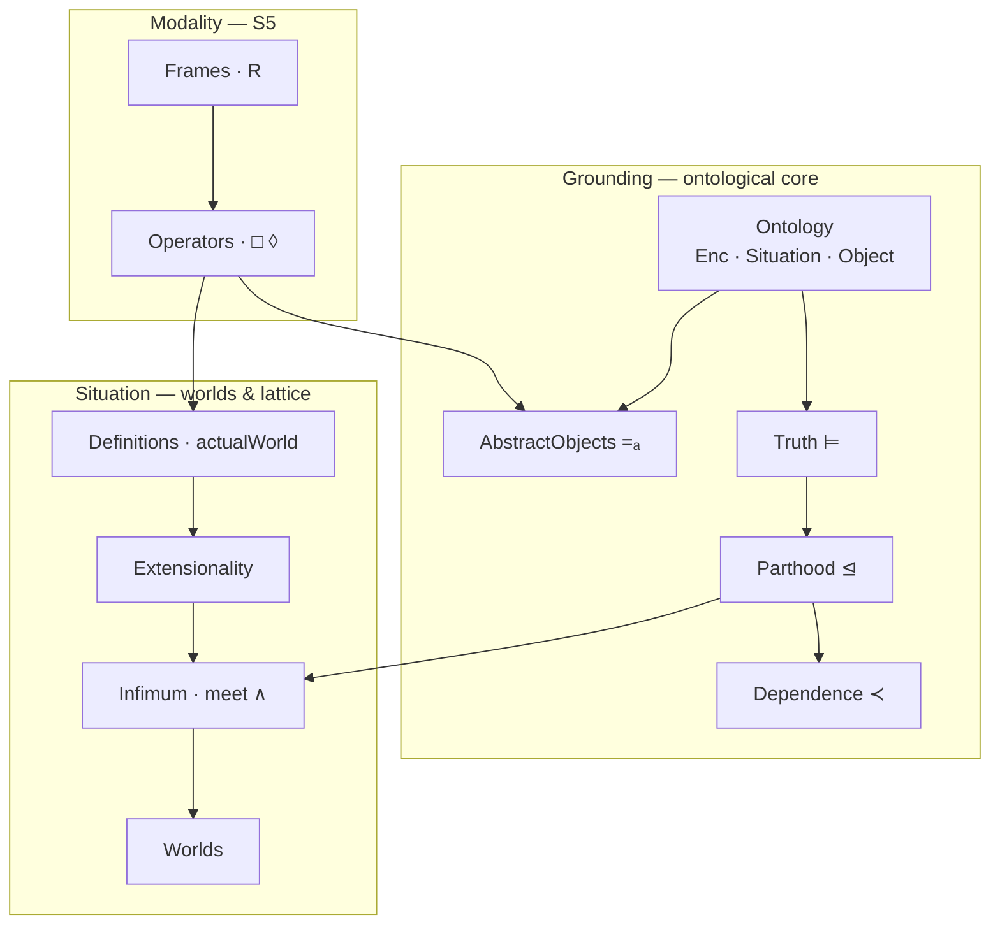
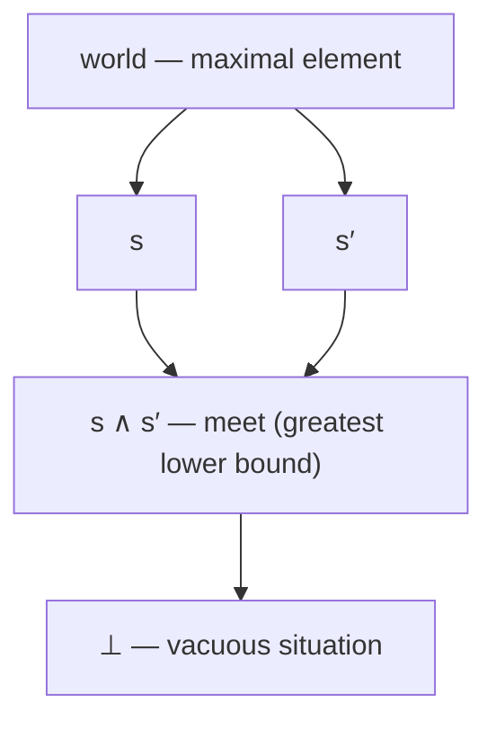

# Possible-World-Semantics

> A machine-checked theory of possible worlds, situations, and modal necessity — formalizing *what could have been*, and proving it, in Lean 4.

[](https://hanielulises.github.io/Possible-World-Semantics/)
[](https://leanprover.github.io/)
[](#open-proof-obligations)
[](#known-issues)
[](LICENSE)

A Lean 4 formalization of possible-world and situation semantics, following the higher-order modal and situation-theoretic tradition of Zalta, Fine, and Barwise–Perry. Every theorem that builds is checked by the Lean kernel, and every remaining gap is tabulated as an open proof obligation or a [known issue](#known-issues). The current axioms have a known collapse: see [KI-1](#ki-1--truth-clauses-collapse-the-situation-lattice) before relying on any result about partial situations.

## Architecture

The development is layered: an ontological **Grounding** core fixes the primitives and their algebra, a **Modality** layer defines `□` and `◊` over an accessibility relation and derives S5, and a **Situation** layer builds worlds and their meet-semilattice on top.



## Getting Started

The toolchain is pinned in `lean-toolchain` (Lean `v4.26.0`), so the build is reproducible — [`elan`](https://github.com/leanprover/elan) selects the right compiler automatically.


## Theoretical Background

The development follows the Zalta–Fine tradition. Worlds and situations are not distinguished at the type level: `World` is the single domain, and `Situation` and `Object` are predicates over it.

The central primitive is encoding (`Enc`). A situation encodes the properties that constitute its informational content. Parthood is defined encoding-first: `s ⊴ s'` holds iff every property encoded by `s` is also encoded by `s'`, matching the mereology of Barwise–Perry and the abstract object theory of Zalta.

Modal operators are defined over a Kripke frame rather than postulated. `Modality/Frames.lean` defines the accessibility relation as universal (`R w v := True`), so reflexivity, transitivity and symmetry hold by computation, and `Modality/Operators.lean` defines `□ p w := ∀ v, R w v → p v` with `◊` as its dual. The S5 schemas are then theorems:

```
□(φ → ψ) → □φ → □ψ          (K)
□φ → φ                      (T)
□φ → □□φ                    (4)
◊φ → □◊φ                    (5)
```

Necessitation (`Nec`) and the collapse `◊□φ → □φ` (`PossNec`) are also theorems. Because `R` is universal, `□ p w` amounts to `∀ v, p v`: the modal layer is S5 with a single equivalence class of worlds, and it has no axioms of its own.

Extensionality is a postulate. Situations are individuated by propositional content:

```
Situation(s) ∧ Situation(s') ∧ (∀p, s ⊨ p ↔ s' ⊨ p) → s = s'
```

This cannot be derived from purely intensional primitives and must be stipulated, which is the standard move in both situation semantics and abstract object theory.

### The situation lattice

Under parthood `⊴`, situations form a meet-semilattice: `⟨Sit, ⊴, ∧⟩`. Worlds are the maximal elements (maximal consistent content); the meet `s ∧ s'` is the greatest lower bound, whose content is exactly what `s` and `s'` share.



*A fragment of the meet-semilattice: edges denote parthood, descending from maximal worlds to the vacuous situation. The structure is a meet-semilattice with distinguished maximal elements, not a complete lattice — see [OP-4](#op-4--lattice-structure-of-meet). Under the current truth clauses this picture collapses to a single point; see [KI-1](#ki-1--truth-clauses-collapse-the-situation-lattice).*

## Axiom Inventory

Every `axiom` declaration in the codebase, grouped by file. Definitions and theorems are not listed. Items marked ⚠ are implicated in a [known issue](#known-issues).

| Axiom | File | Status |
|---|---|---|
| `World`, `Property`, `Propn` | `Grounding/Ontology` | primitive type |
| `Object`, `Situation` | `Grounding/Ontology` | primitive predicate |
| `Enc`, `Encp`, `VAC` | `Grounding/Ontology` | primitive relation / operator |
| `Enc_VAC_complete` | `Grounding/Ontology` | situations encode only propositional properties `VAC p` |
| `situation_is_object` | `Grounding/Ontology` | predicate inclusion postulate (OP-3) |
| `neg` (¬ₚ), `conj` (∧ₚ), `disj` (∨ₚ), `impl` (→ₚ), `bic` | `Grounding/Propositions` | primitive connectives |
| `bic_def`, `impl_as_disj` | `Grounding/Propositions` | definitional equations on `Propn` |
| `neg_neg`, `deMorgan_conj`, `deMorgan_disj` | `Grounding/Propositions` | Boolean identities on `Propn` |
| `conj_comm`, `disj_comm`, `conj_assoc`, `disj_assoc` | `Grounding/Propositions` | Boolean identities on `Propn` |
| `TrueIn` (⊨) | `Grounding/Truth` | primitive relation |
| `Encp_def`, `TrueIn_def` | `Grounding/Truth` | Prover9-verified metatheorems |
| `TrueIn_conj` | `Grounding/Truth` | truth clause for ∧ₚ |
| `TrueIn_disj`, `TrueIn_impl`, `TrueIn_neg` | `Grounding/Truth` | ⚠ classical truth clauses, stated for every `s` |
| `Concrete` | `Grounding/AbstractObjects` | primitive predicate (E!) |
| `ordinary_no_encoding` | `Grounding/AbstractObjects` | ⚠ axiom β (ordinary objects encode nothing) |
| `Comprehension` | `Grounding/AbstractObjects` | comprehension for abstract objects |
| `abstract_extensionality` | `Grounding/AbstractObjects` | constitutive postulate |
| `SitJoin`, `SitJoin_situation` | `Grounding/StructuredProps` | join existence |
| `SitJoin_left`, `SitJoin_right`, `SitJoin_minimal` | `Grounding/StructuredProps` | join is the least upper bound |
| `actualWorld` | `Situation/Definitions` | designated constant |
| `situation_extensionality` | `Situation/Extensionality` | constitutive postulate |
| `situation_extensionality_via_truth` | `Situation/Theorems` | Prover9 Theorem 2; redundant, derivable from `parthood_iff_truth_inclusion` and `parthood_antisymm` |
| `actual_implies_possible` | `Situation/Theorems` | modal postulate |
| `situation_closed_under_parthood` | `Situation/Theorems` | ⚠ Prover9 Theorem 3 |
| `consistent_downward_closed`, `actual_consistent` | `Situation/Theorems` | consistency postulates |
| `meet`, `meet_situation`, `TrueIn_meet` | `Situation/Infimum` | meet existence and truth conditions |
| `world_maximal`, `world_consistent` | `Situation/Worlds` | worlds are maximal and consistent |
| `actualWorld_is_world` | `Situation/Worlds` | the actual world is a world |
| `maximal_consistent_possible_is_world` | `Situation/Worlds` | sufficient condition for worldhood |

The modal layer (`Modality/Frames`, `Modality/Operators`) has no axioms: `R`, `Box` and `Diamond` are definitions, and `K`, `T`, `Four`, `Five`, `Nec` and `PossNec` are theorems.

## Known Issues

These are problems in the axioms or the build, not missing proofs. Each one was confirmed by a Lean derivation or by building the file.

### KI-1 — Truth clauses collapse the situation lattice

`TrueIn_neg` states `s ⊨ ¬ₚp ↔ ¬(s ⊨ p)` for every `s`, so every situation decides every proposition and none can be partial. Combined with `TrueIn_meet`, any two worlds agree on every proposition: the truth of `¬ₚp` at `meet s s'` can be computed both ways, and the two answers only match when `s` and `s'` agree on `p`. With `situation_extensionality_via_truth`, there is then at most one situation:

```lean
theorem all_agree (s s' : World) (p : Propn) : (s ⊨ p) ↔ (s' ⊨ p)
theorem all_situations_equal (s s' : World) : Situation s → Situation s' → s = s'
```

This makes OP-4, OP-5 and the OP-2b repair trivially true rather than informative. In the Oppenheimer–Zalta theory the classical clauses hold only at worlds; restricting `TrueIn_neg`, `TrueIn_disj` and `TrueIn_impl` to `Worldhood s` is the likely fix.

### KI-2 — `ordinary_no_encoding` is mis-scoped

The axiom reads `O! x → □ (fun w => ¬ ∃ F, Enc w F) x`. The bound variable is the world `w`, not the object `x`, and since `R` is universal this says that nothing encodes any property anywhere. `Comprehension` applied to `fun _ => True` produces an object that encodes every property, so one ordinary object and one property are enough to derive `False`. The intended statement is `□ (fun _ => ¬ ∃ F, Enc x F) x`.

### KI-3 — `situation_closed_under_parthood` lacks a hypothesis

The axiom makes every `x` with `x ⊴ s` a situation. Parthood is defined on all of `World`, and an object that encodes nothing is a part of everything, so every such object becomes a situation. Zalta's Theorem 3 ranges over abstract objects only. Nothing currently uses this axiom.

### KI-4 — Build coverage

- `@[default_target]` in `lakefile.lean` applies only to `Grounding`, so `lake build` never compiles `Situation/Infimum.lean`, `Situation/Worlds.lean` or the `Situation` and `Modality` root modules. Use `lake build Grounding Modality Situation` to build everything.
- `Situation/Worlds.lean` does not compile (see [OP-5](#op-5--no-strict-subworld)).
- The `Test` library declared in `lakefile.lean` doesn't match the `Tests/` directory, so the tests never run, and `Tests/Smoke.lean` uses `world_maximal` and `actualWorld_is_world` without importing `Situation.Worlds`.

## Open Proof Obligations

| ID | Obligation | Blocks | File |
|---|---|---|---|
| OP-5 | `no_strict_subworld`, `worlds_distinguished_by_truth`, `distinct_worlds_incomparable` | world-theoretic consequences of maximality | `Situation/Worlds.lean` |

### OP-5 — No strict subworld

`no_strict_subworld` states that no proper part of a world is itself a world. The file has no `sorry` but does not compile, which went unnoticed because `lake build` skips it (KI-4). The proofs use `by_contra` and `push_neg`, which come from Mathlib (not a dependency); use bare terms such as `· (hwx).1` where `exact` is needed; and call `situation_extensionality_via_truth` without importing `Situation.Theorems`. The proof strategy, propagating truth across `⊴` with `part_truth_mono`, `world_maximal` and `TrueIn_neg`, is sound, so repairing the syntax and imports should close it.

## Resolved Proof Obligations

### OP-4 — Lattice structure of meet

`meet_le_left`, `meet_le_right` and `meet_greatest` connect `TrueIn_meet`, which governs truth at the meet, to `PartOf`, which is defined over `Enc`. All three close by applying `truth_mono_to_part` to the truth conditions given by `TrueIn_meet`, with no new axioms. `meet_self` and `meet_comm` follow.

### OP-2b — Dependence is inherited from parts

`parthood_implies_depends` originally stated that if `s ⊴ s'` and `s' ≺ s''`, then `s ≺ s''`. That requires `s ⊴ s' → s ≺ s'`, which is not derivable: `OntologicallyDepends s s'` is `∀ u, Situation u → s ⊴ u → s' ⊴ u`, so dependence runs from a situation to its parts, not to its wholes. Postulating it is not harmless. Instantiating `u := s` turns `s ⊴ s'` into `s' ⊴ s`, and `parthood_antisymm` then makes parthood coincide with identity on situations; with `SitJoin`, any two situations become equal.

Closed by reorienting the statement along the derivable direction. `whole_depends_on_part` proves `s' ⊴ s → s ≺ s'` from `partOf_trans`, and `parthood_implies_depends` now reads: if `s' ⊴ s` and `s' ≺ s''`, then `s ≺ s''` — a whole requires whatever its parts require. No axioms beyond the primitives are used.

### OP-2 — Parthood via truth-monotonicity

`PartOf` is defined over `Enc` while `TrueIn` is an independent primitive. The direction

```
(∀p, s ⊨ p → s' ⊨ p) → s ⊴ s'
```

was not initially derivable, leaving the biconditional `s ⊴ s' ↔ ∀p, s ⊨ p → s' ⊨ p` half-proved and blocking antisymmetry (Theorem 5) and same-parts identity (Theorem 6) of Zalta (1993).

Closed by `truth_mono_to_part` in `Grounding/Parthood.lean`. The proof goes via `Enc_VAC_complete`, where every property encoded by a situation is of the form `VAC p`, so truth-monotonicity in the `TrueIn` sense transfers back to encoding-monotonicity in the `Enc` sense, yielding `s ⊴ s'` directly. No new axioms were needed beyond `Enc_VAC_complete` and `situation_is_object` (OP-3). With this in place, `parthood_iff_truth_inclusion`, `parthood_antisymm`, `same_parts_identity`, and `all_propositions_persistent` all close without `sorry`. Metatheoretic justification: the Prover9 proof `theorem4.in` at peoppenheimer.org/cm/worlds/, Theorem 4 of Zalta (1993).

### OP-1 — Necessitation and possible-necessity collapse

The necessitation rule `(∀w, φw) → ∀w, □φw` and the S5 collapse `◊□φ → □φ` are not derivable from K, T, 4, and 5 alone. Necessitation is admissible in every normal modal logic but is not a substitution instance of any of the schemas. The collapse holds in all S5 frames by euclideanity but requires a frame-level reduction or a direct postulate in a purely axiomatic development.

Both were first closed by postulating `Nec` and `PossNec`. They are now theorems: once `Box` was defined by quantification over the universal relation `R` in `Modality/Frames.lean`, every S5 principle, these two included, became a direct calculation, and the modal axioms were removed.

### OP-3 — Situations are objects

`TrueIn_def` and `Encp_def` both require an `Object x` hypothesis. `Situation` and `Object` are independent predicates with nothing forcing their extensions to overlap. The bridge `Situation(s) → Object(s)` was postulated as `situation_is_object` in `Grounding/Ontology.lean`.

With this in place, `part_truth_mono` closes without `sorry`: the direction `s ⊴ s' → (s ⊨ p → s' ⊨ p)` is fully derived by unfolding `TrueIn_def` and `Encp_def` on both sides and applying encoding-monotonicity of `PartOf` directly.

## Derived Theory

Beyond the core obligations, the development carries several families of
purely derived results (no new postulates beyond those tabulated above):

- **Modal calculus** (`Modality/Operators`). On top of the S5 core, `□`/`◊`
  duality (`Box_iff_not_Diamond_not`), the monotonicity of `◊`
  (`Diamond_monotone`), distribution laws (`Diamond_distrib_disj`,
  `Box_distrib_conj`), and the contingency vocabulary (`Necessary`,
  `Impossible`, `Contingent`) with their exclusion theorems. Each is a
  calculation over the universal accessibility relation `R`.

- **Propositional algebra** (`Grounding/Propositions`). Contraposition
  (`impl_contrapositive`) alongside the De Morgan and double-negation laws.

- **Abstract-object identity** (`Grounding/AbstractObjects`). Zalta's
  encoding-identity `=ₐ` (`IdentityA`) as an equivalence relation, its
  collapse to `=` under `abstract_extensionality`, and the promotion of
  `Comprehension` to a definite description (`abstract_object_unique`).

- **Grounding structure** (`Grounding/Dependence`). Strict dependence,
  grounding as asymmetric dependence (`WeaklyGrounds`, `weakly_grounds_asymm`),
  and the exhaustiveness of the foundational/derivative dichotomy
  (`not_foundational_iff_derivative`).

## Contributing

Contributions are welcome, especially proofs and axiom repairs. Good entry points:

| Item | Where | What it needs |
|---|---|---|
| [OP-5](#op-5--no-strict-subworld) | `Situation/Worlds.lean` | Syntax and import repairs; the proof strategy is already in place. **Best first proof.** |
| [KI-2](#ki-2--ordinary_no_encoding-is-mis-scoped) | `Grounding/AbstractObjects.lean` | Rebind the encoding subject from `w` to `x`. |
| [KI-1](#ki-1--truth-clauses-collapse-the-situation-lattice) | `Grounding/Truth.lean` | Restrict the classical truth clauses to worlds, then repair whatever depends on them. The most substantial item. |

**Ground rules.**

- No new axioms without discussion. If a proof genuinely needs a postulate, open an issue first — the whole point of the [Axiom Inventory](#axiom-inventory) is that it stays complete and honest.
- Every `sorry` must correspond to exactly one row in [Open Proof Obligations](#open-proof-obligations); if you close one, delete its row and (if it unblocks others) update the dependent entries.
- `lake build Grounding Modality Situation` must pass with no errors and no new `sorry`.

To get started: pick an obligation above, open an issue to claim it, then send a PR. Questions and partial attempts are just as welcome as finished proofs.

## References

Zalta, E. *Intensional Logic and the Metaphysics of Intentionality*. MIT Press, 1988.

Fine, K. "Ontological Dependence." *Proceedings of the Aristotelian Society*, 1995.

Barwise, J. and Perry, J. *Situations and Attitudes*. MIT Press, 1983.

Oppenheimer, P. and Zalta, E. "The Computational Theory of Possible Worlds." peoppenheimer.org/cm/worlds/
