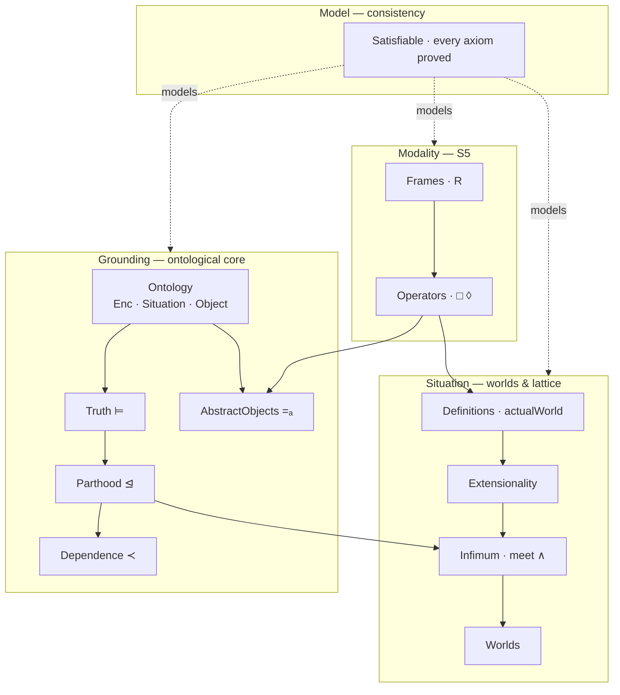
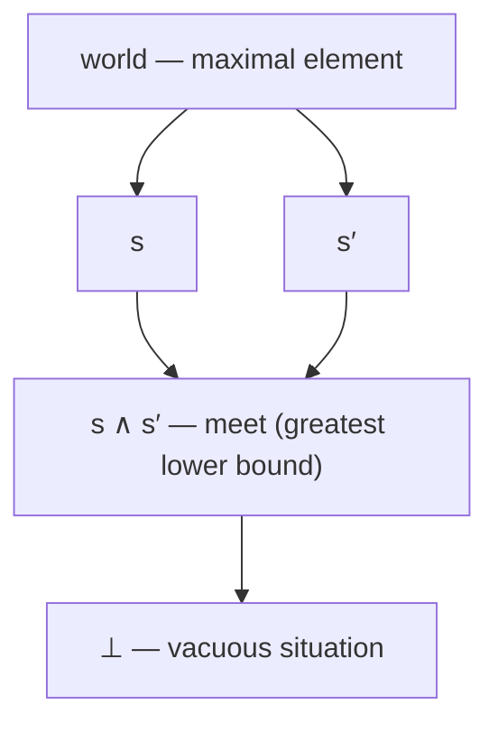

# Possible-World-Semantics

> A machine-checked theory of possible worlds, situations, and modal necessity — formalizing *what could have been*, and proving it, in Lean 4.

[](https://hanielulises.github.io/Possible-World-Semantics/)
[](https://leanprover.github.io/)
[](#open-proof-obligations)
[](#consistency-and-a-model)
[](LICENSE)

A Lean 4 formalization of possible-world and situation semantics, following the higher-order modal and situation-theoretic tradition of Zalta, Fine, and Barwise–Perry. Every theorem is checked by the Lean kernel, every axiom is tabulated in the [inventory](#axiom-inventory), and a [concrete model](#consistency-and-a-model) proves the axioms consistent and non-degenerate: there are distinct worlds, contingent propositions, and partial situations strictly below worlds.

## Architecture

The development is layered: an ontological **Grounding** core fixes the primitives and their algebra, a **Modality** layer defines `□` and `◊` over an accessibility relation and derives S5, and a **Situation** layer builds worlds and their meet-semilattice on top. A separate **Model** proves every axiom true in a concrete structure.



## Getting Started

The toolchain is pinned in `lean-toolchain` (Lean `v4.26.0`), so the build is reproducible — [`elan`](https://github.com/leanprover/elan) selects the right compiler automatically. There are no external dependencies; the development uses only Lean core.

```bash
git clone https://github.com/HanielUlises/Possible-World-Semantics.git
cd Possible-World-Semantics
lake build
```

`lake build` compiles the three libraries, the model in `Model/` and the tests in `Tests/`. `scripts/check.sh` does the same from a clean state and then runs `scripts/check_model.py`, which confirms that the model still matches every axiom.

To see which axioms a theorem rests on, open a file and use `#print axioms`:

```lean
import Grounding.Dependence
#print axioms parthood_implies_depends
```

## Theoretical Background

The development follows the Zalta–Fine tradition. Worlds and situations are not distinguished at the type level: `World` is the single domain, and `Situation` and `Object` are predicates over it.

The central primitive is encoding (`Enc`). A situation encodes the properties that constitute its informational content. Parthood is defined encoding-first: `s ⊴ s'` holds iff every property encoded by `s` is also encoded by `s'`, matching the mereology of Barwise–Perry and the abstract object theory of Zalta.

Situated truth and obtaining are kept apart. `s ⊨ p` (`TrueIn`) is truth in a situation and is partial: a situation may make neither `p` nor `¬ₚp` true. `Obtains v p` is "p is the case at index v", where indices are the points over which `□` and `◊` quantify; the classical clauses (`Obtains_neg`, `Obtains_conj`, `Obtains_disj`, `Obtains_impl`) govern it alone. Following Zalta, a world is a situation that could make true exactly what is the case:

```
Worldhood(s)  :=  Situation(s) ∧ ◊(λv. ∀p, s ⊨ p ↔ Obtains v p)
Actual(s)     :=  ∀p, s ⊨ p → Obtains @ p
Possible(s)   :=  ◊(λv. ∀p, s ⊨ p → Obtains v p)
```

With these definitions the classical behaviour of truth at worlds, and the maximality and consistency of worlds, are theorems rather than postulates (`Situation/Worlds.lean`), and worlds are characterised as exactly the maximal possible situations (`worldhood_iff`).

Modal operators are defined over a Kripke frame rather than postulated. `Modality/Frames.lean` defines the accessibility relation as universal (`R w v := True`), so reflexivity, transitivity and symmetry hold by computation, and `Modality/Operators.lean` defines `□ p w := ∀ v, R w v → p v` with `◊` as its dual. The S5 schemas are then theorems:

```
□(φ → ψ) → □φ → □ψ          (K)
□φ → φ                      (T)
□φ → □□φ                    (4)
◊φ → □◊φ                    (5)
```

Necessitation (`Nec`) and the collapse `◊□φ → □φ` (`PossNec`) are also theorems. Because `R` is universal, `□ p w` amounts to `∀ v, p v`: the modal layer is S5 with a single equivalence class of worlds, and it has no axioms of its own.

Extensionality is a postulate. Situations are individuated by propositional content:

```
Situation(s) ∧ Situation(s') ∧ (∀p, s ⊨ p ↔ s' ⊨ p) → s = s'
```

This cannot be derived from purely intensional primitives and must be stipulated, which is the standard move in both situation semantics and abstract object theory.

### The situation lattice

Under parthood `⊴`, situations form a meet-semilattice: `⟨Sit, ⊴, ∧⟩`. Worlds are the maximal elements (maximal consistent content); the meet `s ∧ s'` is the greatest lower bound, whose content is exactly what `s` and `s'` share.



*A fragment of the meet-semilattice: edges denote parthood, descending from maximal worlds to the vacuous situation. The structure is a meet-semilattice with distinguished maximal elements, not a complete lattice — see [OP-4](#op-4--lattice-structure-of-meet).*

## Axiom Inventory

Every `axiom` declaration in the codebase, grouped by file. Definitions and theorems are not listed. Every axiom below is proved true in the [model](#consistency-and-a-model).

| Axiom | File | Status |
|---|---|---|
| `World`, `Property`, `Propn` | `Grounding/Ontology` | primitive type |
| `Object`, `Situation` | `Grounding/Ontology` | primitive predicate |
| `Enc`, `Encp`, `VAC` | `Grounding/Ontology` | primitive relation / operator |
| `Enc_VAC_complete` | `Grounding/Ontology` | situations encode only propositional properties `VAC p` |
| `situation_is_object` | `Grounding/Ontology` | predicate inclusion postulate (OP-3) |
| `neg` (¬ₚ), `conj` (∧ₚ), `disj` (∨ₚ), `impl` (→ₚ), `bic` | `Grounding/Propositions` | primitive connectives |
| `bic_def`, `impl_as_disj` | `Grounding/Propositions` | definitional equations on `Propn` |
| `neg_neg`, `deMorgan_conj`, `deMorgan_disj` | `Grounding/Propositions` | Boolean identities on `Propn` |
| `conj_comm`, `disj_comm`, `conj_assoc`, `disj_assoc` | `Grounding/Propositions` | Boolean identities on `Propn` |
| `TrueIn` (⊨) | `Grounding/Truth` | primitive relation: truth in a situation |
| `Encp_def`, `TrueIn_def` | `Grounding/Truth` | Prover9-verified metatheorems |
| `Obtains` | `Grounding/Truth` | primitive relation: a proposition is the case at an index |
| `Obtains_neg`, `Obtains_conj`, `Obtains_disj`, `Obtains_impl` | `Grounding/Truth` | classical clauses for obtaining |
| `Concrete` | `Grounding/AbstractObjects` | primitive predicate (E!) |
| `ordinary_no_encoding` | `Grounding/AbstractObjects` | axiom β (ordinary objects encode nothing) |
| `Comprehension` | `Grounding/AbstractObjects` | comprehension for abstract objects |
| `abstract_extensionality` | `Grounding/AbstractObjects` | constitutive postulate |
| `SitJoin`, `SitJoin_situation` | `Grounding/StructuredProps` | join existence |
| `SitJoin_left`, `SitJoin_right`, `SitJoin_minimal` | `Grounding/StructuredProps` | join is the least upper bound |
| `actualWorld` | `Situation/Definitions` | designated constant |
| `situation_extensionality` | `Situation/Extensionality` | constitutive postulate |
| `situation_closed_under_parthood` | `Situation/Theorems` | Prover9 Theorem 3, for abstract parts |
| `meet`, `meet_situation`, `TrueIn_meet` | `Situation/Infimum` | meet existence and truth conditions |
| `actualWorld_faithful` | `Situation/Worlds` | the actual world's truths are what obtains at the actual index |

The modal layer (`Modality/Frames`, `Modality/Operators`) has no axioms: `R`, `Box` and `Diamond` are definitions, and `K`, `T`, `Four`, `Five`, `Nec` and `PossNec` are theorems.

Formerly postulated, now derived: `world_maximal`, `world_consistent`, `maximal_consistent_possible_is_world`, `actualWorld_is_world` (`Situation/Worlds`); `situation_extensionality_via_truth`, `actual_implies_possible`, `actual_consistent`, `consistent_downward_closed` (`Situation/Theorems`).

`Obtains`, its four classical clauses and `actualWorld_faithful` were introduced on 2026-11-18 to repair [KI-1 and KI-5](#repaired-axioms), and were reviewed and accepted under the no-new-axioms rule. The four clauses relocate the former `TrueIn_neg`, `TrueIn_conj`, `TrueIn_disj` and `TrueIn_impl` from situated truth to obtaining, and `actualWorld_faithful` replaces `actualWorld_is_world`. It could be removed by defining `Situation` as Zalta does and deriving the actual world from `Comprehension`.

## Consistency and a Model

`Model/Satisfiable.lean` builds a concrete structure in which every axiom holds. It imports nothing from the development. Each primitive gets a concrete definition under its original name, each definition that an axiom mentions is copied verbatim, and each axiom is restated verbatim as a theorem and proved using only Lean's own logic. `scripts/check_model.py` confirms that the statements, definitions and notations match the development exactly, so the model cannot silently drift from the axioms. Since every axiom is true in the model, no contradiction is derivable from them.

The structure is small:

- two valuations, `true` (actual) and `false`, serve as indices;
- a proposition is a set of valuations, so the connectives are Boolean operations;
- properties are propositions, and `VAC` is the identity;
- objects are either indices, which are concrete and encode nothing (the ordinary objects), or abstract objects, one per set of properties (the situations);
- `abs S ⊨ p` holds iff `p ∈ S`, and `Obtains v p` evaluates `p` at the valuation of `v`.

`Model.nondegenerate` shows that the theory is not degenerate in this structure:

| Property | Witness |
|---|---|
| Two distinct worlds | `actualWorld`, `otherWorld` |
| A contingent proposition | `contingentProp`: possibly the case, and possibly not |
| A partial situation strictly below a world | `emptySituation ⊴ actualWorld`, `Partial₁ emptySituation` |
| Possible situations that are not worlds | `emptySituation` |
| An impossible situation | `trivialSituation`, which makes everything true |
| Ordinary and abstract objects | `idx true`, `actualWorld` |

### Repaired axioms

Earlier versions of the axioms collapsed in four ways. All four are repaired, and the model rules each of them out.

- **KI-1 — Classical truth at every situation.** `TrueIn_neg`, `TrueIn_conj`, `TrueIn_disj` and `TrueIn_impl` held for every `s`, so no situation could be partial; with `TrueIn_meet` and extensionality there was at most one situation. The clauses now govern `Obtains` instead, and hold for `⊨` only at worlds, where they are derived.
- **KI-2 — `ordinary_no_encoding` was mis-scoped.** It said that the evaluation index encodes nothing, so `Comprehension` derived `False` from any ordinary object. The encoding subject is now the object itself.
- **KI-3 — `situation_closed_under_parthood` covered ordinary objects.** An ordinary object encodes nothing, so it is part of every situation and became a situation. The axiom now ranges over abstract parts only, as in Zalta's Theorem 3.
- **KI-5 — Worldhood left no propositions.** `Worldhood` made every proposition true, `¬ₚp` included, so with `actualWorld_is_world` the axioms proved `Propn` empty. It now uses Zalta's clause, with `Obtains v p` for "p is the case".

## Open Proof Obligations

None. Every `sorry` must correspond to exactly one row here; the codebase currently has none.

## Resolved Proof Obligations

### OP-5 — No strict subworld

`no_strict_subworld` states that no proper part of a world is itself a world. The file had no `sorry` but did not compile, which went unnoticed because `lake build` only built the `Grounding` library. It relied on the Mathlib-only tactics `by_contra` and `push_neg`, used bare terms where `exact` was needed, and called `situation_extensionality_via_truth` without importing `Situation.Theorems`. With those repaired, `no_strict_subworld`, `worlds_distinguished_by_truth` and `distinct_worlds_incomparable` close by propagating truth across `⊴` with `part_truth_mono`, `world_maximal`, `world_consistent` and `world_TrueIn_neg`. Every library and test is now a default build target.

### OP-4 — Lattice structure of meet

`meet_le_left`, `meet_le_right` and `meet_greatest` connect `TrueIn_meet`, which governs truth at the meet, to `PartOf`, which is defined over `Enc`. All three close by applying `truth_mono_to_part` to the truth conditions given by `TrueIn_meet`, with no new axioms. `meet_self` and `meet_comm` follow.

### OP-2b — Dependence is inherited from parts

`parthood_implies_depends` originally stated that if `s ⊴ s'` and `s' ≺ s''`, then `s ≺ s''`. That requires `s ⊴ s' → s ≺ s'`, which is not derivable: `OntologicallyDepends s s'` is `∀ u, Situation u → s ⊴ u → s' ⊴ u`, so dependence runs from a situation to its parts, not to its wholes. Postulating it is not harmless. Instantiating `u := s` turns `s ⊴ s'` into `s' ⊴ s`, and `parthood_antisymm` then makes parthood coincide with identity on situations; with `SitJoin`, any two situations become equal.

Closed by reorienting the statement along the derivable direction. `whole_depends_on_part` proves `s' ⊴ s → s ≺ s'` from `partOf_trans`, and `parthood_implies_depends` now reads: if `s' ⊴ s` and `s' ≺ s''`, then `s ≺ s''` — a whole requires whatever its parts require. No axioms beyond the primitives are used.

### OP-2 — Parthood via truth-monotonicity

`PartOf` is defined over `Enc` while `TrueIn` is an independent primitive. The direction

```
(∀p, s ⊨ p → s' ⊨ p) → s ⊴ s'
```

was not initially derivable, leaving the biconditional `s ⊴ s' ↔ ∀p, s ⊨ p → s' ⊨ p` half-proved and blocking antisymmetry (Theorem 5) and same-parts identity (Theorem 6) of Zalta (1993).

Closed by `truth_mono_to_part` in `Grounding/Parthood.lean`. The proof goes via `Enc_VAC_complete`, where every property encoded by a situation is of the form `VAC p`, so truth-monotonicity in the `TrueIn` sense transfers back to encoding-monotonicity in the `Enc` sense, yielding `s ⊴ s'` directly. No new axioms were needed beyond `Enc_VAC_complete` and `situation_is_object` (OP-3). With this in place, `parthood_iff_truth_inclusion`, `parthood_antisymm`, `same_parts_identity`, and `all_propositions_persistent` all close without `sorry`. Metatheoretic justification: the Prover9 proof `theorem4.in` at peoppenheimer.org/cm/worlds/, Theorem 4 of Zalta (1993).

### OP-1 — Necessitation and possible-necessity collapse

The necessitation rule `(∀w, φw) → ∀w, □φw` and the S5 collapse `◊□φ → □φ` are not derivable from K, T, 4, and 5 alone. Necessitation is admissible in every normal modal logic but is not a substitution instance of any of the schemas. The collapse holds in all S5 frames by euclideanity but requires a frame-level reduction or a direct postulate in a purely axiomatic development.

Both were first closed by postulating `Nec` and `PossNec`. They are now theorems: once `Box` was defined by quantification over the universal relation `R` in `Modality/Frames.lean`, every S5 principle, these two included, became a direct calculation, and the modal axioms were removed.

### OP-3 — Situations are objects

`TrueIn_def` and `Encp_def` both require an `Object x` hypothesis. `Situation` and `Object` are independent predicates with nothing forcing their extensions to overlap. The bridge `Situation(s) → Object(s)` was postulated as `situation_is_object` in `Grounding/Ontology.lean`.

With this in place, `part_truth_mono` closes without `sorry`: the direction `s ⊴ s' → (s ⊨ p → s' ⊨ p)` is fully derived by unfolding `TrueIn_def` and `Encp_def` on both sides and applying encoding-monotonicity of `PartOf` directly.

## Derived Theory

Beyond the core obligations, the development carries several families of
purely derived results (no new postulates beyond those tabulated above):

- **Modal calculus** (`Modality/Operators`). On top of the S5 core, `□`/`◊`
  duality (`Box_iff_not_Diamond_not`), the monotonicity of `◊`
  (`Diamond_monotone`), distribution laws (`Diamond_distrib_disj`,
  `Box_distrib_conj`), and the contingency vocabulary (`Necessary`,
  `Impossible`, `Contingent`) with their exclusion theorems. Each is a
  calculation over the universal accessibility relation `R`.

- **Propositional algebra** (`Grounding/Propositions`). Contraposition
  (`impl_contrapositive`) alongside the De Morgan and double-negation laws.

- **Abstract-object identity** (`Grounding/AbstractObjects`). Zalta's
  encoding-identity `=ₐ` (`IdentityA`) as an equivalence relation, its
  collapse to `=` under `abstract_extensionality`, and the promotion of
  `Comprehension` to a definite description (`abstract_object_unique`).

- **World theory** (`Situation/Worlds`). Truth at a world matches what
  obtains at some index (`world_index`), so the classical clauses hold at
  worlds (`world_TrueIn_neg`, `world_TrueIn_conj`, `world_TrueIn_disj`,
  `world_TrueIn_impl`); worlds are maximal, consistent and possible;
  possible situations are consistent (`possible_consistent`); and worlds
  are exactly the maximal possible situations (`worldhood_iff`).

- **Grounding structure** (`Grounding/Dependence`). Strict dependence,
  grounding as asymmetric dependence (`WeaklyGrounds`, `weakly_grounds_asymm`),
  and the exhaustiveness of the foundational/derivative dichotomy
  (`not_foundational_iff_derivative`).

## Contributing

Contributions are welcome, especially new proofs. Good entry points:

| Item | Where | What it needs |
|---|---|---|
| Frame correspondence | `Modality/` | Generalise `R` to an arbitrary relation and prove that T, 4, B and 5 correspond to reflexive, transitive, symmetric and euclidean frames, justifying the universal `R`. |
| Mechanised model link | `Model/` | Bundle the primitives and axioms into a structure so that the model is checked against the axioms by Lean itself, rather than textually by `check_model.py`. |
| Dependence and modality | `Grounding/Dependence.lean` | State and prove modal facts about ≺ and ⊴, such as rigidity of parthood. |

**Ground rules.**

- No new axioms without discussion. If a proof genuinely needs a postulate, open an issue first — the whole point of the [Axiom Inventory](#axiom-inventory) is that it stays complete and honest.
- Every `sorry` must correspond to exactly one row in [Open Proof Obligations](#open-proof-obligations); if you close one, delete its row and (if it unblocks others) update the dependent entries.
- `lake build` must pass with no errors, no warnings and no new `sorry`.
- If you add or change an axiom, update `Model/Satisfiable.lean` so that it still proves every axiom; `scripts/check_model.py` must pass.

To get started: pick an item above, open an issue to claim it, then send a PR. Questions and partial attempts are just as welcome as finished proofs.

## References

Zalta, E. *Intensional Logic and the Metaphysics of Intentionality*. MIT Press, 1988.

Fine, K. "Ontological Dependence." *Proceedings of the Aristotelian Society*, 1995.

Barwise, J. and Perry, J. *Situations and Attitudes*. MIT Press, 1983.

Oppenheimer, P. and Zalta, E. "The Computational Theory of Possible Worlds." peoppenheimer.org/cm/worlds/
