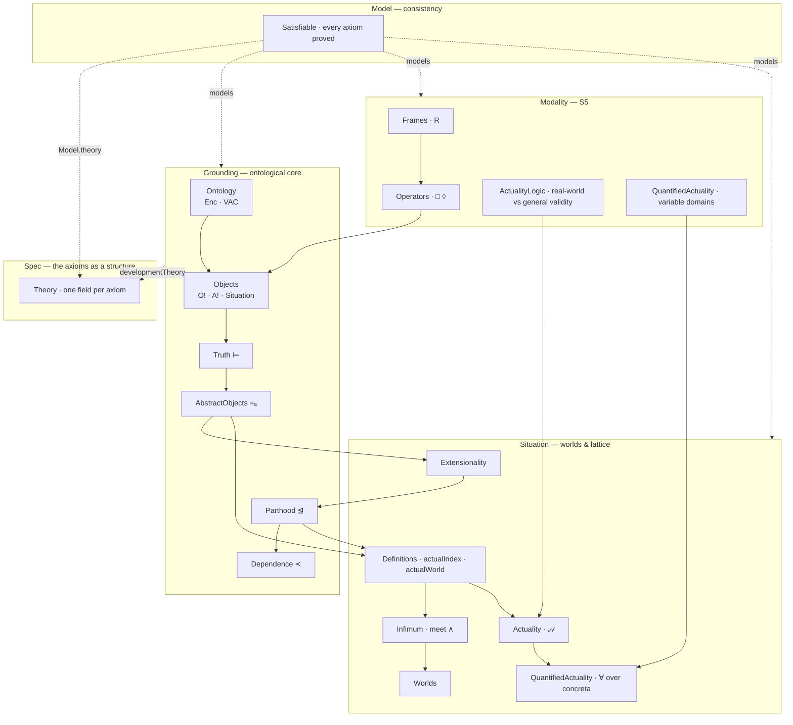
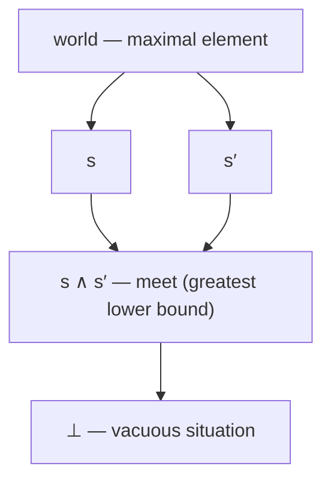
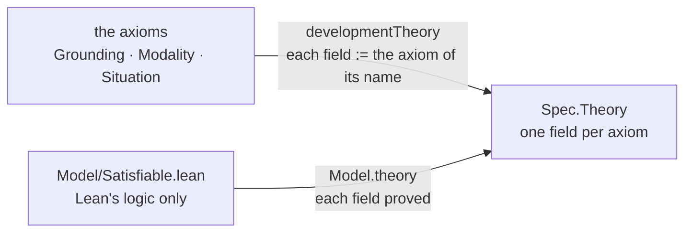

# Possible-World-Semantics

> A machine-checked theory of possible worlds, situations, and modal necessity — formalizing *what could have been*, and proving it, in Lean 4.

[](https://github.com/HanielUlises/Possible-World-Semantics/actions/workflows/ci.yml)
[](https://hanielulises.github.io/Possible-World-Semantics/)
[](https://leanprover.github.io/)
[](#open-proof-obligations)
[](#consistency-and-a-model)
[](LICENSE)

A Lean 4 formalization of possible-world and situation semantics, following the higher-order modal and situation-theoretic tradition of Zalta, Fine, and Barwise–Perry. Every theorem is checked by the Lean kernel, every axiom is tabulated in the [inventory](#axiom-inventory), and a [concrete model](#consistency-and-a-model) proves the axioms consistent and non-degenerate: there are distinct worlds, contingent propositions, and partial situations strictly below worlds. With an actuality operator, the development also machine-checks [contingent logical truths](#actuality-and-contingent-logical-truths): `p ↔ 𝒜p` is true at the actual world in every model, but its necessitation is not.

## Architecture

The development is layered: an ontological **Grounding** core fixes the primitives and their algebra, a **Modality** layer defines `□` and `◊` over an accessibility relation and derives S5, and a **Situation** layer builds worlds and their meet-semilattice on top. A separate **Model** proves every axiom true in a concrete structure, and **Spec** bundles the axioms into one structure against which Lean checks both.



## Getting Started

The toolchain is pinned in `lean-toolchain` (Lean `v4.26.0`), so the build is reproducible — [`elan`](https://github.com/leanprover/elan) selects the right compiler automatically. There are no external dependencies; the development uses only Lean core.

```bash
git clone https://github.com/HanielUlises/Possible-World-Semantics.git
cd Possible-World-Semantics
lake build
```

`lake build` compiles the three libraries, the specification in `Spec/`, the model in `Model/` and the tests in `Tests/`. `scripts/check.sh` does the same from a clean state, treating every warning (including `sorry`) as an error. Among the tests, `Tests/Specification.lean` checks that every axiom is a field of `Spec.Theory`, and `Tests/Model.lean` checks that the model is built from Lean's own logic alone (see [Consistency and a Model](#consistency-and-a-model)). CI runs `scripts/check.sh` on every push to `main` and on every pull request.

To see which axioms a theorem rests on, open a file and use `#print axioms`:

```lean
import Grounding.Dependence
#print axioms parthood_implies_depends
```

## Theoretical Background

The development follows the Zalta–Fine tradition. Worlds and situations are not distinguished at the type level: `World` is the single domain, and `Situation` and `Object` are predicates over it.

The central primitive is encoding (`Enc`). A situation encodes the properties that constitute its informational content. As in Zalta's theory, situations are defined as abstract objects that encode only propositional properties, the vacuous properties `VAC p` (written `[λy p]` by Zalta):

```
Object(x)     :=  O!(x) ∨ A!(x)
Situation(x)  :=  A!(x) ∧ ∀F, x encodes F → ∃p, F = VAC p
```

`O!` (ordinary: possibly concrete) and `A!` (abstract: not possibly concrete) are defined from the primitive `Concrete` in `Grounding/Objects.lean`. Parthood is defined encoding-first: `s ⊴ s'` holds iff every property encoded by `s` is also encoded by `s'`, matching the mereology of Barwise–Perry and the abstract object theory of Zalta.

Situated truth and obtaining are kept apart. `s ⊨ p` (`TrueIn`) is truth in a situation and is partial: a situation may make neither `p` nor `¬ₚp` true. `Obtains v p` is "p is the case at index v", where indices are the points over which `□` and `◊` quantify; the classical clauses (`Obtains_neg`, `Obtains_conj`, `Obtains_disj`, `Obtains_impl`) govern it alone. Following Zalta, a world is a situation that could make true exactly what is the case. Writing `@` for the actual index `actualIndex`:

```
Worldhood(s)  :=  Situation(s) ∧ ◊(λv. ∀p, s ⊨ p ↔ Obtains v p)
Actual(s)     :=  ∀p, s ⊨ p → Obtains @ p
Possible(s)   :=  ◊(λv. ∀p, s ⊨ p → Obtains v p)
```

The actual world is not postulated. `actualWorld` is the abstract object that `Comprehension` provides for the vacuous properties of what obtains at `@`, so that it encodes `VAC p` exactly when `Obtains @ p`. That it is a world faithful to `@` (`actualWorld_faithful`) is then a theorem. The one bridge it needs is `VAC_congr`: if `VAC p = VAC q`, then `p` and `q` obtain at the same indices. In Zalta's theory this follows from β-conversion; the development has no exemplification relation, so it is postulated directly.

With these definitions the classical behaviour of truth at worlds, and the maximality and consistency of worlds, are theorems rather than postulates (`Situation/Worlds.lean`), and worlds are characterised as exactly the maximal possible situations (`worldhood_iff`).

Modal operators are defined over a Kripke frame rather than postulated. `Modality/Frames.lean` defines the accessibility relation as universal (`R w v := True`), so reflexivity, transitivity and symmetry hold by computation, and `Modality/Operators.lean` defines `□ p w := ∀ v, R w v → p v` with `◊` as its dual. The S5 schemas are then theorems:

```
□(φ → ψ) → □φ → □ψ          (K)
□φ → φ                      (T)
□φ → □□φ                    (4)
◊φ → □◊φ                    (5)
```

Necessitation (`Nec`) and the collapse `◊□φ → □φ` (`PossNec`) are also theorems. Because `R` is universal, `□ p w` amounts to `∀ v, p v`: the modal layer is S5 with a single equivalence class of worlds, and it has no axioms of its own.

Situations are individuated by propositional content:

```
Situation(s) ∧ Situation(s') ∧ (∀p, s ⊨ p ↔ s' ⊨ p) → s = s'
```

This is a theorem (`situation_extensionality`). Situations that make the same propositions true encode the same vacuous properties, and since they encode nothing else, `abstract_extensionality` identifies them. The postulate is therefore made once, for abstract objects, as in Zalta's theory.

### The situation lattice

Under parthood `⊴`, situations form a meet-semilattice: `⟨Sit, ⊴, ∧⟩`. Worlds are the maximal elements (maximal consistent content); the meet `s ∧ s'` is the greatest lower bound, whose content is exactly what `s` and `s'` share. Like the actual world, the meet is not postulated: `meet s s'` is the abstract object that `Comprehension` gives for the properties encoded by both `s` and `s'`, and its truth conditions (`TrueIn_meet`) are a theorem. The join `SitJoin` is defined in the same way.



*A fragment of the meet-semilattice: edges denote parthood, descending from maximal worlds to the vacuous situation. The structure is a meet-semilattice with distinguished maximal elements, not a complete lattice — see [OP-4](#op-4--lattice-structure-of-meet).*

## Actuality and Contingent Logical Truths

Zalta (1988) argued that a modal language with an actuality operator has logical truths that are not necessary, for example `p ↔ 𝒜p`. The claim turns on the distinction between *real-world validity* (truth at the actual world of every model) and *general validity* (truth at every world of every model), due to Crossley and Humberstone (1977) and Davies and Humberstone (1980). The development machine-checks it at three levels, without adding any axiom.

**The metatheory** (`Modality/ActualityLogic.lean`). A deep embedding of propositional modal logic with `□` and `𝒜`, interpreted in Kripke models with a designated actual world. For an arbitrary class of models:

| Result | Theorem |
|---|---|
| General validity implies real-world validity; both are closed under modus ponens | `GValid.rwValid`, `RWValid.mp`, `GValid.mp` |
| General validity is closed under necessitation | `GValid.nec` |
| `φ ↔ 𝒜φ` is real-world valid for every `φ` | `actuality_rwValid` |
| Neither it nor `□(φ ↔ 𝒜φ)` is valid in the stronger sense, in any class containing a two-world model (S5, universal) | `actuality_not_gValid`, `box_actuality_not_rwValid` |
| Real-world validity is strictly weaker, and not closed under necessitation | `rwValid_strictly_weaker`, `rwValid_not_closed_under_nec`, `contingent_logical_truth_S5` |
| `□(φ ↔ 𝒜φ)` holds exactly when `φ` is non-contingent | `sat_box_actuality`, `sat_box_actuality_universal` |
| `𝒜` is inert for real-world validity; `𝒜φ` is generally valid iff `φ` is real-world valid | `rwValid_act_iff`, `gValid_act_iff` |

**The theory** (`Situation/Actuality.lean`). `𝒜 p` is *defined* as `p` evaluated at the actual index `actualIndex`. Then `actuality_truth` (`p ↔ 𝒜p` at the actual index) holds by definition, `box_actuality_truth_iff` shows that its necessitation holds exactly when `p` is necessary or impossible, and `contingent_actuality_truth_not_necessary` concludes that for contingent `p` it is not necessary. `sat_theoryModel` proves that reading the development as a model of the deep embedding gives the same truth conditions, so every real-world valid formula holds actually (`rwValid_holds_actually`).

**Quantified modal logic** (`Modality/QuantifiedActuality.lean`). The same comparison for first-order modal logic with actuality, over Kripke models with variable domains and actualist quantifiers. The closure properties and the characterization of `□(φ ↔ 𝒜φ)` carry over under every assignment. Variable domains add contingent logical truths of their own:

| Result | Theorem |
|---|---|
| Both validities are closed under generalization | `RWValid.gen`, `GValid.gen` |
| `𝒜∀xφ ↔ ∀x𝒜φ` is real-world valid, and generally valid over constant domains | `commute_rwValid`, `commute_gValid_constant` |
| "Everything actually exists", `∀x 𝒜E!x`, is real-world valid; `□∀x 𝒜E!x` holds exactly when no accessible world has an object that does not actually exist | `allActual_rwValid`, `sat_box_allActual` |
| Neither is generally valid, nor is its necessitation real-world valid, in any class containing a two-world model with a growing domain | `commute_not_gValid`, `allActual_not_gValid`, `box_allActual_not_rwValid` |
| "Everything exists", `∀x E!x`, is generally valid | `allExist_gValid` |

**Quantification in the theory** (`Situation/QuantifiedActuality.lean`). The quantifiers of the theory, like Zalta's, range over the single domain `World`. Concreteness, however, is relative to an index (`Concrete v x`), so the objects concrete at an index form a domain that can vary. `AllConcrete` defines actualist quantification over that domain, with no new axiom:

| Result | Theorem |
|---|---|
| "Everything concrete is actually concrete" holds at the actual index | `everythingActuallyConcrete_actual` |
| Its necessitation holds exactly when nothing could be concrete without actually being concrete | `box_everythingActuallyConcrete_iff` |
| If something could be concrete without actually being so, neither it nor the commutation of `𝒜` with the quantifier is necessary | `everythingActuallyConcrete_not_necessary`, `concreteCommute_not_necessary` |
| "Everything concrete is concrete" is necessary | `box_everythingConcrete` |
| The possibilist quantifier satisfies the Barcan formula and its converse; for the actualist quantifier, the Barcan formula holds at an index exactly when no possible domain exceeds its domain, and the converse exactly when its domain is included in every possible domain | `possibilist_barcan`, `barcan_iff`, `converseBarcan_iff` |
| The theory is a model of the quantified deep embedding, with the concrete objects at an index as its domain; every real-world valid formula holds actually | `sat_quantTheoryModel`, `rwValid_holds_actually_quantified`, `sat_allActual_theory` |

**The model** (`Model/Satisfiable.lean`). The theory does not decide whether anything is contingent, or whether the domain of concrete objects varies. `Model.contingent_logical_truth` shows that in a model of *all* the axioms, the actuality truth for a contingent proposition holds at the actual world while its necessitation fails. `Model.quantified_contingent_logical_truth` does the same for "everything concrete is actually concrete", since the model's domain grows at the non-actual index (`Model.growing_domain`); for the same reason both Barcan formulas fail there for the actualist quantifier (`Model.barcan_fails`, `Model.converseBarcan_fails`). This is the reading of contingent existence that Linsky and Zalta (1994) give for the simplest quantified modal logic: a constant domain, with contingency carried by concreteness.

A paper describing these results is in [`paper/`](paper/).

## Axiom Inventory

Every `axiom` declaration in the codebase, grouped by file. Definitions and theorems are not listed. Every axiom below is proved true in the [model](#consistency-and-a-model).

| Axiom | File | Status |
|---|---|---|
| `World`, `Property`, `Propn` | `Grounding/Ontology` | primitive type |
| `Enc`, `Encp`, `VAC` | `Grounding/Ontology` | primitive relation / operator |
| `Concrete` | `Grounding/Objects` | primitive predicate (E!) |
| `neg` (¬ₚ), `conj` (∧ₚ), `disj` (∨ₚ), `impl` (→ₚ), `bic` | `Grounding/Propositions` | primitive connectives |
| `bic_def`, `impl_as_disj` | `Grounding/Propositions` | definitional equations on `Propn` |
| `neg_neg`, `deMorgan_conj`, `deMorgan_disj` | `Grounding/Propositions` | Boolean identities on `Propn` |
| `conj_comm`, `disj_comm`, `conj_assoc`, `disj_assoc` | `Grounding/Propositions` | Boolean identities on `Propn` |
| `TrueIn` (⊨) | `Grounding/Truth` | primitive relation: truth in a situation |
| `Encp_def`, `TrueIn_def` | `Grounding/Truth` | Prover9-verified metatheorems |
| `Obtains` | `Grounding/Truth` | primitive relation: a proposition is the case at an index |
| `Obtains_neg`, `Obtains_conj`, `Obtains_disj`, `Obtains_impl` | `Grounding/Truth` | classical clauses for obtaining |
| `VAC_congr` | `Grounding/Truth` | equal vacuous properties have the same obtaining conditions |
| `ordinary_no_encoding` | `Grounding/AbstractObjects` | axiom β (ordinary objects encode nothing) |
| `Comprehension` | `Grounding/AbstractObjects` | comprehension for abstract objects |
| `abstract_extensionality` | `Grounding/AbstractObjects` | constitutive postulate |
| `actualIndex` | `Situation/Definitions` | designated constant: the actual index |

The modal layer (`Modality/Frames`, `Modality/Operators`) has no axioms: `R`, `Box` and `Diamond` are definitions, and `K`, `T`, `Four`, `Five`, `Nec` and `PossNec` are theorems.

Formerly postulated, now derived: `situation_is_object`, `Enc_VAC_complete` (`Grounding/Objects`); `SitJoin_situation`, `SitJoin_left`, `SitJoin_right`, `SitJoin_minimal` (`Grounding/StructuredProps`); `meet_situation`, `TrueIn_meet` (`Situation/Infimum`); `situation_extensionality` (`Situation/Extensionality`); `world_maximal`, `world_consistent`, `maximal_consistent_possible_is_world`, `actualWorld_is_world`, `actualWorld_faithful` (`Situation/Worlds`); `situation_extensionality_via_truth`, `situation_closed_under_parthood`, `actual_implies_possible`, `actual_consistent`, `consistent_downward_closed` (`Situation/Theorems`). Formerly primitive, now defined: `Object`, `Situation` (`Grounding/Objects`), `SitJoin` (`Grounding/StructuredProps`), `actualWorld` (`Situation/Definitions`) and `meet` (`Situation/Infimum`).

`Obtains`, its four classical clauses and `actualWorld_faithful` were introduced on 2026-11-18 to repair [KI-1 and KI-5](#repaired-axioms), and were reviewed and accepted under the no-new-axioms rule. The four clauses relocate the former `TrueIn_neg`, `TrueIn_conj`, `TrueIn_disj` and `TrueIn_impl` from situated truth to obtaining. On 2026-11-22, `Object` and `Situation` were defined as in Zalta's theory and the former constant `actualWorld` was split into the primitive index `actualIndex` and a world defined by comprehension. This turned seven axioms into definitions or theorems, `actualWorld_faithful` among them, at the cost of one new axiom, `VAC_congr`, which was also reviewed and accepted. The meet and join of situations were then defined by comprehension as well, as the abstract objects encoding the properties that both, respectively either, of their arguments encode; this removed eight further axioms and added none.

## Consistency and a Model

`Spec/Theory.lean` bundles the primitives and axioms into a structure, `Spec.Theory`, with one field per axiom, and defines the derived notions (`Situation`, `Worldhood`, `Actually`, `Barcan`, …) once over an arbitrary theory. It imports nothing. Lean checks the model against the axioms through this structure, with nothing compared textually:



- `developmentTheory` (`Situation/Specification.lean`) fills every field with the axiom of the same name, so Lean checks that each axiom has exactly the statement of its field.
- `#check_axioms_are_fields` (`Spec/Check.lean`, run in `Tests/Specification.lean`) checks the converse. Every `axiom` in `Grounding/`, `Modality/` and `Situation/` must be a field, every field must be filled by its own axiom, and every source file must be imported, so a new axiom cannot be missed.
- `Model.theory` (`Model/Satisfiable.lean`) is a second instance, built from a concrete structure. The file imports only `Spec.Theory`, nothing from the development. `#check_only_core_axioms` (run in `Tests/Model.lean`) fails unless it uses nothing beyond `propext`, `Classical.choice` and `Quot.sound`: no `sorry` and no axiom of the development.
- `rfl` lemmas on both sides (`Specification.*_eq`, `Model.Spec.*_eq`) show that the definitions each side uses coincide with those of `Spec.Theory`, so the results about the model below mean what they say in the development.

Since every axiom is true in the model, no contradiction is derivable from them (`Model.consistent`).

The structure is small:

- two valuations, `true` (actual) and `false`, serve as indices;
- a proposition is a set of valuations with a tag bit; the connectives are Boolean operations on the sets and take the disjunction of the tags, and obtaining ignores the tag;
- properties are propositions, and `VAC` is the identity;
- objects are either indices, which encode nothing (the ordinary objects), or abstract objects, one per set of properties (the situations);
- abstract objects are concrete nowhere; only `idx true` is concrete at the actual index, while both indices are concrete at `idx false`, so the domain of concrete objects grows;
- `abs S ⊨ p` holds iff `p ∈ S`, and `Obtains v p` evaluates `p` at the valuation of `v`;
- the actual index is `idx true`, and the actual world, defined by comprehension as in the development, is the abstract object encoding what holds at `true` (`actualWorld_eq`).

`Model.nondegenerate` shows that the theory is not degenerate in this structure:

| Property | Witness |
|---|---|
| Two distinct worlds | `actualWorld`, `otherWorld` |
| A contingent proposition | `contingentProp`: possibly the case, and possibly not |
| A partial situation strictly below a world | `emptySituation ⊴ actualWorld`, `Partial₁ emptySituation` |
| Possible situations that are not worlds | `emptySituation` |
| An impossible situation | `trivialSituation`, which makes everything true |
| Ordinary and abstract objects | `idx true`, `actualWorld` |
| An object that could be concrete but is not actually concrete | `idx false` (`growing_domain`) |

`Model.hyperintensional` shows that the axioms do not make propositions intensional, although the propositional identities hold. `contingentProp` and `variantProp` differ only in their tag, so they obtain at the same indices but are distinct, and the possible situation `singletonSituation` makes the first true but not the second.

### Repaired axioms

Earlier versions of the axioms collapsed in four ways. All four are repaired, and the model rules each of them out.

- **KI-1 — Classical truth at every situation.** `TrueIn_neg`, `TrueIn_conj`, `TrueIn_disj` and `TrueIn_impl` held for every `s`, so no situation could be partial; with `TrueIn_meet` and extensionality there was at most one situation. The clauses now govern `Obtains` instead, and hold for `⊨` only at worlds, where they are derived.
- **KI-2 — `ordinary_no_encoding` was mis-scoped.** It said that the evaluation index encodes nothing, so `Comprehension` derived `False` from any ordinary object. The encoding subject is now the object itself.
- **KI-3 — `situation_closed_under_parthood` covered ordinary objects.** An ordinary object encodes nothing, so it is part of every situation and became a situation. The axiom now ranges over abstract parts only, as in Zalta's Theorem 3.
- **KI-5 — Worldhood left no propositions.** `Worldhood` made every proposition true, `¬ₚp` included, so with `actualWorld_is_world` the axioms proved `Propn` empty. It now uses Zalta's clause, with `Obtains v p` for "p is the case".

`Situation/Variants.lean` machine-checks the two main collapses against the current axioms. Each variant's extra assumption is a hypothesis, so no axiom is added:

| Variant | Consequence | Theorem |
|---|---|---|
| Negation classical for `⊨` at every object (KI-1) | any two objects make the same propositions true; at most one situation | `classical_truth_collapse`, `classical_truth_one_situation` |
| Worldhood with a tautology in place of obtaining (KI-5) | if the actual world is a world and negation is classical there, `Propn` is empty | `tautological_worldhood_empty` |

## Open Proof Obligations

None. `main` is kept free of `sorry`, and CI rejects any. An open obligation is recorded here and worked on in an issue or a branch; it lands on `main` only once it is closed.

## Resolved Proof Obligations

### OP-5 — No strict subworld

`no_strict_subworld` states that no proper part of a world is itself a world. The file had no `sorry` but did not compile, which went unnoticed because `lake build` only built the `Grounding` library. It relied on the Mathlib-only tactics `by_contra` and `push_neg`, used bare terms where `exact` was needed, and called `situation_extensionality_via_truth` without importing `Situation.Theorems`. With those repaired, `no_strict_subworld`, `worlds_distinguished_by_truth` and `distinct_worlds_incomparable` close by propagating truth across `⊴` with `part_truth_mono`, `world_maximal`, `world_consistent` and `world_TrueIn_neg`. Every library and test is now a default build target.

### OP-4 — Lattice structure of meet

`meet_le_left`, `meet_le_right` and `meet_greatest` connect `TrueIn_meet`, which governs truth at the meet, to `PartOf`, which is defined over `Enc`. All three close by applying `truth_mono_to_part` to the truth conditions given by `TrueIn_meet`, with no new axioms. `meet_self` and `meet_comm` follow.

### OP-2b — Dependence is inherited from parts

`parthood_implies_depends` originally stated that if `s ⊴ s'` and `s' ≺ s''`, then `s ≺ s''`. That requires `s ⊴ s' → s ≺ s'`, which is not derivable: `OntologicallyDepends s s'` is `∀ u, Situation u → s ⊴ u → s' ⊴ u`, so dependence runs from a situation to its parts, not to its wholes. Postulating it is not harmless. Instantiating `u := s` turns `s ⊴ s'` into `s' ⊴ s`, and `parthood_antisymm` then makes parthood coincide with identity on situations; with `SitJoin`, any two situations become equal.

Closed by reorienting the statement along the derivable direction. `whole_depends_on_part` proves `s' ⊴ s → s ≺ s'` from `partOf_trans`, and `parthood_implies_depends` now reads: if `s' ⊴ s` and `s' ≺ s''`, then `s ≺ s''` — a whole requires whatever its parts require. No axioms beyond the primitives are used.

### OP-2 — Parthood via truth-monotonicity

`PartOf` is defined over `Enc` while `TrueIn` is an independent primitive. The direction

```
(∀p, s ⊨ p → s' ⊨ p) → s ⊴ s'
```

was not initially derivable, leaving the biconditional `s ⊴ s' ↔ ∀p, s ⊨ p → s' ⊨ p` half-proved and blocking antisymmetry (Theorem 5) and same-parts identity (Theorem 6) of Zalta (1993).

Closed by `truth_mono_to_part` in `Grounding/Parthood.lean`. The proof goes via `Enc_VAC_complete`, where every property encoded by a situation is of the form `VAC p`, so truth-monotonicity in the `TrueIn` sense transfers back to encoding-monotonicity in the `Enc` sense, yielding `s ⊴ s'` directly. No new axioms were needed beyond `Enc_VAC_complete` and `situation_is_object` (OP-3). With this in place, `parthood_iff_truth_inclusion`, `parthood_antisymm`, `same_parts_identity`, and `all_propositions_persistent` all close without `sorry`. Metatheoretic justification: the Prover9 proof `theorem4.in` at peoppenheimer.org/cm/worlds/, Theorem 4 of Zalta (1993).

### OP-1 — Necessitation and possible-necessity collapse

The necessitation rule `(∀w, φw) → ∀w, □φw` and the S5 collapse `◊□φ → □φ` are not derivable from K, T, 4, and 5 alone. Necessitation is admissible in every normal modal logic but is not a substitution instance of any of the schemas. The collapse holds in all S5 frames by euclideanity but requires a frame-level reduction or a direct postulate in a purely axiomatic development.

Both were first closed by postulating `Nec` and `PossNec`. They are now theorems: once `Box` was defined by quantification over the universal relation `R` in `Modality/Frames.lean`, every S5 principle, these two included, became a direct calculation, and the modal axioms were removed.

### OP-3 — Situations are objects

`TrueIn_def` and `Encp_def` both require an `Object x` hypothesis. `Situation` and `Object` are independent predicates with nothing forcing their extensions to overlap. The bridge `Situation(s) → Object(s)` was postulated as `situation_is_object` in `Grounding/Ontology.lean`. Since 2026-11-22 both predicates are defined as in Zalta's theory (`Grounding/Objects.lean`), and `situation_is_object` is a theorem.

With this in place, `part_truth_mono` closes without `sorry`: the direction `s ⊴ s' → (s ⊨ p → s' ⊨ p)` is fully derived by unfolding `TrueIn_def` and `Encp_def` on both sides and applying encoding-monotonicity of `PartOf` directly.

## Derived Theory

Beyond the core obligations, the development carries several families of
purely derived results (no new postulates beyond those tabulated above):

- **Modal calculus** (`Modality/Operators`). On top of the S5 core, `□`/`◊`
  duality (`Box_iff_not_Diamond_not`), the monotonicity of `◊`
  (`Diamond_monotone`), distribution laws (`Diamond_distrib_disj`,
  `Box_distrib_conj`), and the contingency vocabulary (`Necessary`,
  `Impossible`, `Contingent`) with their exclusion theorems. Each is a
  calculation over the universal accessibility relation `R`.

- **Propositional algebra** (`Grounding/Propositions`). Contraposition
  (`impl_contrapositive`) alongside the De Morgan and double-negation laws.

- **Abstract-object identity** (`Grounding/AbstractObjects`). Zalta's
  encoding-identity `=ₐ` (`IdentityA`) as an equivalence relation, its
  collapse to `=` under `abstract_extensionality`, and the promotion of
  `Comprehension` to a definite description (`abstract_object_unique`).

- **World theory** (`Situation/Worlds`). Truth at a world matches what
  obtains at some index (`world_index`), so the classical clauses hold at
  worlds (`world_TrueIn_neg`, `world_TrueIn_conj`, `world_TrueIn_disj`,
  `world_TrueIn_impl`); worlds are maximal, consistent and possible;
  possible situations are consistent (`possible_consistent`); and worlds
  are exactly the maximal possible situations (`worldhood_iff`).

- **Actuality** (`Situation/Actuality`). `𝒜` is rigid
  (`actually_rigid`), idempotent (`actually_actually`) and necessary
  when true (`box_actually`, `diamond_actually`); actuality of a
  situation is the actualisation of its possibility condition
  (`actual_iff_actually`).

- **Grounding structure** (`Grounding/Dependence`). Strict dependence,
  grounding as asymmetric dependence (`WeaklyGrounds`, `weakly_grounds_asymm`),
  and the exhaustiveness of the foundational/derivative dichotomy
  (`not_foundational_iff_derivative`).

## Contributing

Contributions are welcome, especially new proofs. Good entry points:

| Item | Where | What it needs |
|---|---|---|
| Frame correspondence | `Modality/` | Generalise `R` to an arbitrary relation and prove that T, 4, B and 5 correspond to reflexive, transitive, symmetric and euclidean frames, justifying the universal `R`. |
| Dependence and modality | `Grounding/Dependence.lean` | State and prove modal facts about ≺ and ⊴, such as rigidity of parthood. |

**Ground rules.**

- No new axioms without discussion. If a proof genuinely needs a postulate, open an issue first — the whole point of the [Axiom Inventory](#axiom-inventory) is that it stays complete and honest.
- `scripts/check.sh` must pass: no errors, no warnings and no `sorry`. CI enforces this on every pull request.
- Record a proof you cannot finish as a row in [Open Proof Obligations](#open-proof-obligations) and keep the `sorry` on a branch; when you close one, delete its row and (if it unblocks others) update the dependent entries.
- If you add or change an axiom, add or change its field in `Spec/Theory.lean` and in both `developmentTheory` and `Model.theory`; the build fails until all three agree.

To get started: pick an item above, open an issue to claim it, then send a PR. Questions and partial attempts are just as welcome as finished proofs.

## References

Zalta, E. *Intensional Logic and the Metaphysics of Intentionality*. MIT Press, 1988.

Zalta, E. "Logical and Analytic Truths That Are Not Necessary." *Journal of Philosophy* 85(2), 1988.

Crossley, J. N. and Humberstone, I. L. "The Logic of 'Actually'." *Reports on Mathematical Logic* 8, 1977.

Davies, M. and Humberstone, L. "Two Notions of Necessity." *Philosophical Studies* 38, 1980.

Linsky, B. and Zalta, E. "In Defense of the Simplest Quantified Modal Logic." *Philosophical Perspectives* 8, 1994.

Barcan, R. C. "A Functional Calculus of First Order Based on Strict Implication." *Journal of Symbolic Logic* 11(1), 1946.

Fine, K. "Ontological Dependence." *Proceedings of the Aristotelian Society*, 1995.

Barwise, J. and Perry, J. *Situations and Attitudes*. MIT Press, 1983.

Oppenheimer, P. and Zalta, E. "The Computational Theory of Possible Worlds." peoppenheimer.org/cm/worlds/
